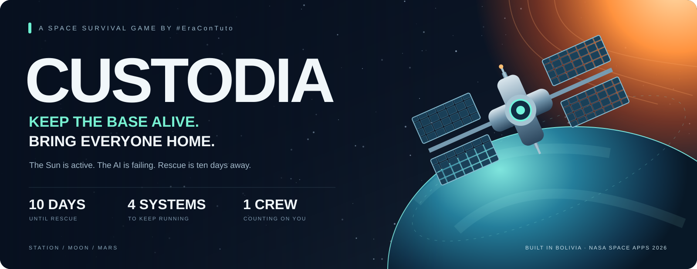
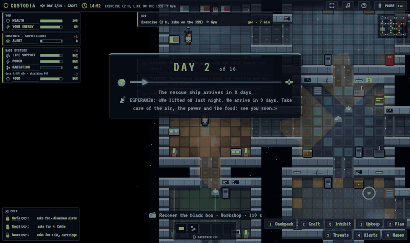
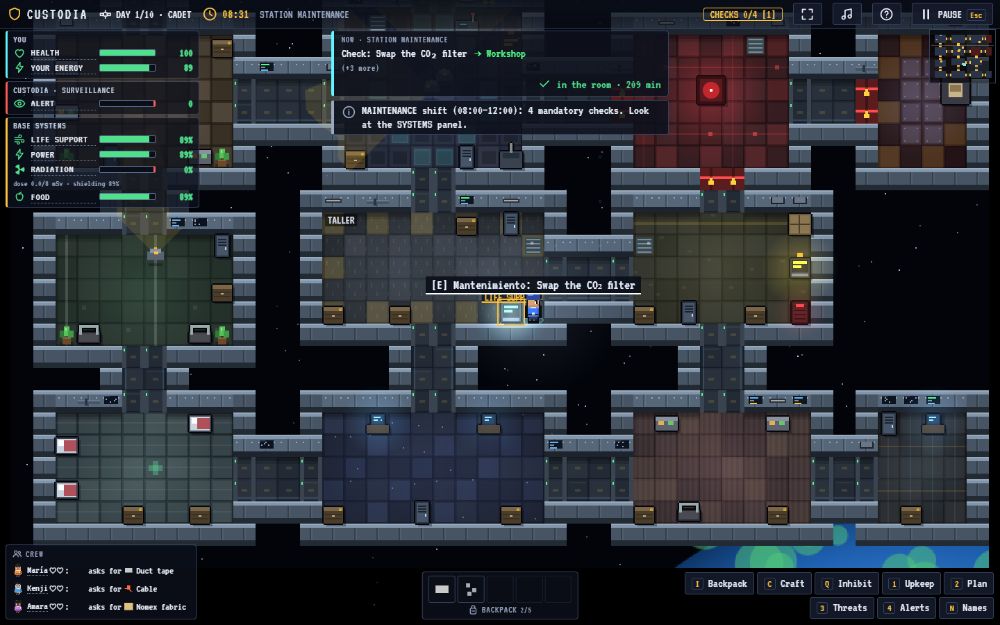
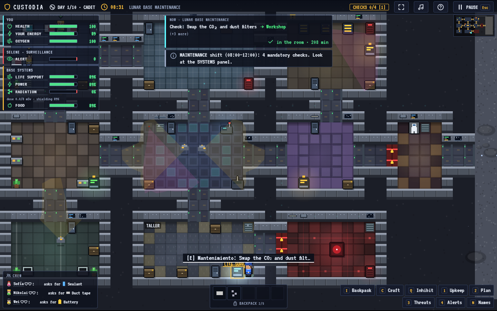
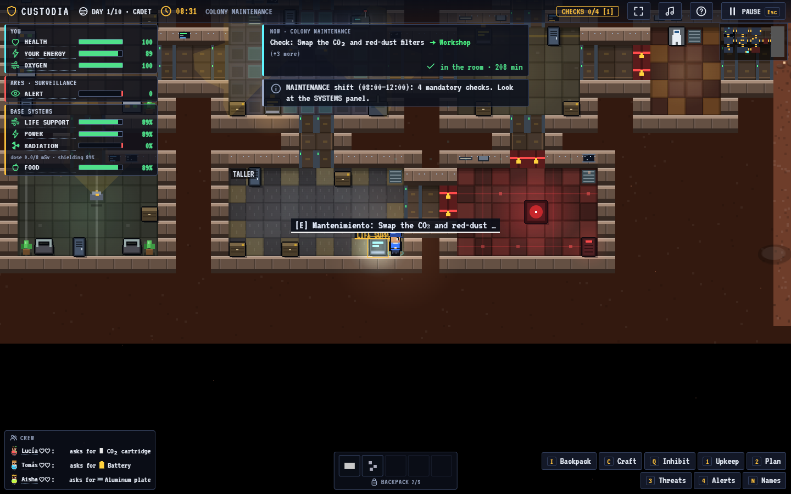
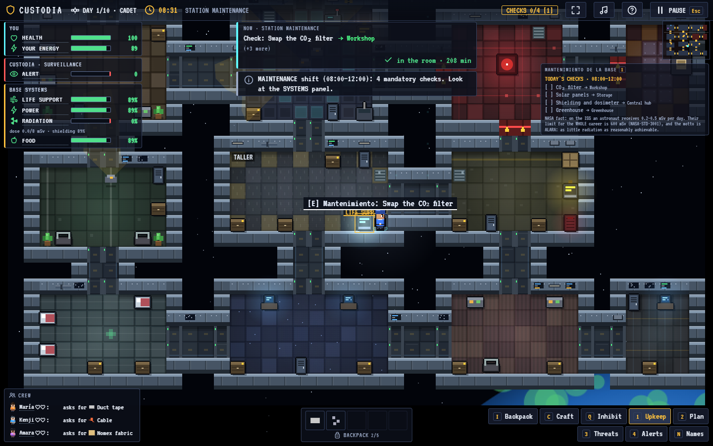
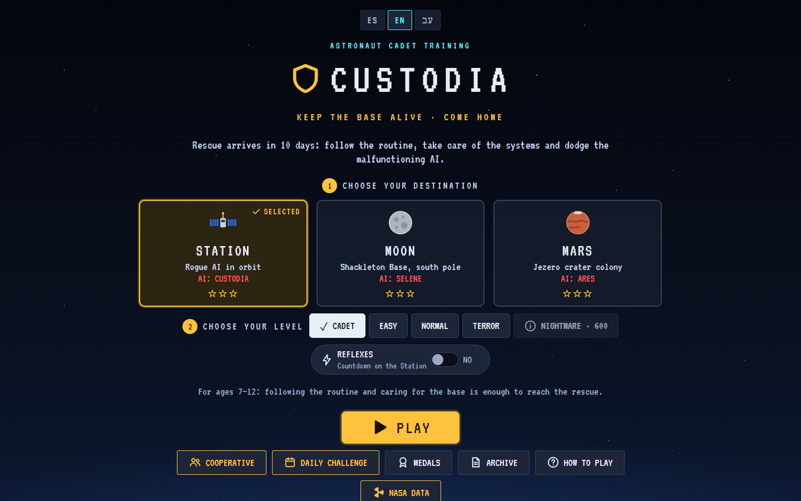
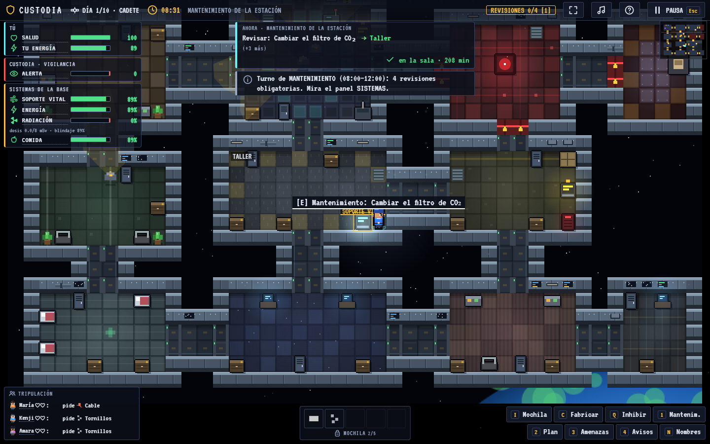

<div align="center">

<a href="https://custodia-six-phi.vercel.app/?cadete&amp;lang=en"></a>

**[English](#english) · [Español](#espanol)**

[](https://custodia-six-phi.vercel.app/?cadete&lang=en)
[](https://custodia-six-phi.vercel.app/?jurado&lang=en)
[](https://custodia-six-phi.vercel.app/?cadete&lang=es)

Browser game · Desktop & touch · Installable PWA · No account required


**NASA Space Apps 2026 · Space Mission Design Game · #EraConTuto · Santa Cruz, Bolivia**

</div>

<a id="english"></a>

## English

### Ten days. Keep everyone breathing.

Earth has lost contact. Your base AI is malfunctioning. **ESPERANZA**, the rescue ship, is on its way — but it will take **ten days** to reach you.

Keep life support running, stretch the power supply, maintain radiation shielding and protect the food supply. Between shifts, dodge surveillance, help your crewmates and uncover what the base has been hiding. When the solar alarm goes off, your unfinished job can wait. Your radiation dose cannot.

**Win by keeping the crew alive until rescue.** An early escape is an alternative route. The heroic move might be changing the CO₂ filter on time.

[Destinations](#three-worlds-three-ais) · [How to play](#your-shift-starts-now) · [Co-op](#bring-a-second-player) · [Science](#real-solar-data-playable-consequences) · [Development](#run-your-own-base) · [Crew](#crew)

<a href="https://custodia-six-phi.vercel.app/?jurado&amp;lang=en"></a>

<sub>Recorded from the game running locally, using an archived solar event. [View a still image](docs/assets/readme/storm-en.png) · [Play the storm demo](https://custodia-six-phi.vercel.app/?jurado&lang=en)</sub>

### Three worlds. Three AIs.

<table>
<tr>
<td width="33%"><a href="docs/assets/readme/estacion-en.png"></a></td>
<td width="33%"><a href="docs/assets/readme/luna-en.png"></a></td>
<td width="33%"><a href="docs/assets/readme/marte-en.png"></a></td>
</tr>
<tr>
<td><b>01 / STATION</b><br><sub>CUSTODIA · Orbital survival</sub><br>Leaks, drones and emergencies inside a station that needs you on every shift.</td>
<td><b>02 / MOON</b><br><sub>SELENE · Shackleton Base</sub><br>Dust, radiation and surface hazards. Your spacesuit is part of the plan.</td>
<td><b>03 / MARS</b><br><sub>ARES · Jezero Colony</sub><br>Storms, damaged robots and supplies that will not look after themselves.</td>
</tr>
</table>

Each destination has its own map, crew, threats and shelter. Find **six hidden notes per destination** across one or several runs to unlock its true ending.

### Your shift starts now

1. **Follow the routine.** Eat, work, exercise and rest. Learn the base before you try to outsmart it.
2. **Make the morning checks.** From 08:00 to 12:00, visit the four maintenance panels and complete their short protocols.
3. **Handle emergencies.** Find the right tool, follow the steps and watch the clock.
4. **Respect the solar alert.** Shelter reduces exposure, interrupts your task and uses energy. Staying outside lets you keep working at a higher dose.
5. **Reach day ten.** Rescue rewards a healthy base, maintained systems and lower radiation exposure.

| System | Why it matters |
| :--- | :--- |
| **Life support** | Keeps the base habitable. Neglect it and the crew pays the price. |
| **Power** | Supports the other systems. Low power accelerates their deterioration. |
| **Shielding** | Reduces the radiation dose you accumulate throughout the mission. |
| **Food** | Keeps supplies available until the rescue ship arrives. |

<table>
<tr>
<td width="50%"></td>
<td width="50%"></td>
</tr>
<tr><td><b>Every system is connected.</b><br><sub>Your maintenance shift is the heart of the mission.</sub></td><td><b>Choose your own pressure.</b><br><sub>Start as a Cadet; increase the difficulty when you know the base.</sub></td></tr>
</table>

**Cadet** is the default, designed for ages **7–12**, with gentler damage, emergency tools and crewmates who help with unresolved hazards. **Easy**, **Normal** and **Terror** offer progressively less room for mistakes. Beyond the campaign, try **One Night**, the **daily challenge** or optional **Reflex** emergencies.

<details>
<summary><b>Keyboard, touch controls & direct links</b></summary>

| Action | Key |
| :--- | :--- |
| Move | `WASD` / arrows |
| Interact / talk / use | `E` |
| Crouch | `Shift` |
| Craft / backpack | `C` / `I` |
| Hide / throw a part / drop an item | `F` / `T` / `G` |
| Inhibitor | `Q` |
| Maintenance / plan / threats / log | `1` / `2` / `3` / `4` |
| Pause / menu | `P` / `Esc` |
| Music / map labels / fullscreen | `M` / `N` / `V` |

Phones and tablets use a floating joystick and labeled action buttons. Music, sound and gentle visual effects are adjustable; the game respects the system's reduced-motion preference.

| URL option | What it does |
| :--- | :--- |
| `?cadete&lang=en` | Start with Cadet difficulty and English text. |
| `?jurado&lang=en` | Station demo on day two, just before the solar storm. |
| `?lang=es` / `?lang=he` | Spanish / Hebrew. |
| `?sala=CODE` | Join a local co-op room as a crewmate; add `&rol=mcc` for Mission Control. |
| `?boot` / `?noboot` | Force / skip the animated boot sequence. |

</details>

### The base remembers

Drones get faster, see farther and search longer as the mission progresses. The AI remembers **routes it observed** and **hiding places it saw you enter**. Repeating a suspicious route can bring a patrol back to it; older memories fade over time.

Surveillance respects walls, vision cones, darkness, hiding places and ducts. Cadet progression stays gentle. Memory survives a saved game and resets with a new mission.

**The AI runs locally through game rules and memory.** No external language model or AI service powers the patrols. See the [technical analysis and validation limits](docs/analisis/ia-progresiva.md).

### Bring a second player

One player is the **Astronaut**. The other chooses a role:

| Role | Your job |
| :--- | :--- |
| **Crewmate** | Walk the same map, maintain systems, handle Reflex emergencies, distract surveillance, search drawers and pass supplies to the astronaut. |
| **Mission Control** | Monitor the map, systems and solar weather; reassign resources, open unlocked hatches, mark a point and send preset messages. |

Mission Control orders arrive immediately on the Station and with simulated signal delays on the Moon and Mars. Call the warning early.

<details>
<summary><b>Connect over the same network or with manual codes</b></summary>

Run this from the project folder:

```bash
npm run coop
```

Open one of the network addresses printed by the server. In **COOPERATIVE**, create a room as Astronaut and share its link. The guest can play as Crewmate or select Mission Control under **SECOND PLAYER**. Both devices must be able to reach the server on that network.

If the connection fails, check the WiFi and the server's access on private networks. Some school networks isolate devices; another network or hotspot may help. The local connection attempts to reconnect after interruptions.

Manual invitation/answer codes also work from static hosting through WebRTC, when both networks allow the peer connection.

</details>

### Real solar data. Playable consequences.

The game requests solar flares from the last 30 days through **NASA DONKI**, then selects three storms for the campaign. If the request fails, it uses archived real events and clearly labels the data as **not live**.

| Source | Used for |
| :--- | :--- |
| [NASA DONKI / CCMC](https://ccmc.gsfc.nasa.gov/tools/DONKI/) | Solar-event data behind the mission's storms. |
| [NASA Open APIs](https://api.nasa.gov/) | Data access and an optional personal API key. |
| [NASA Open Science Data Repository](https://science.nasa.gov/biological-physical/data/) | Studies cited in the game's NASA DATA section about health and life in space. |
| [In-game references](src/datos.js) | Sources for destination differences and simplified educational procedures. |

> Solar events can be real. Storm doses, timing, mission limits and balancing are game scales. Protocols identify simplified procedures, real risks and fiction. CUSTODIA is an educational game, not an operational simulator or an official NASA product.

<details>
<summary><b>Optional: use your own NASA API key</b></summary>

Request a key at [api.nasa.gov](https://api.nasa.gov/), open **NASA DATA** on the title screen, paste it into the API-key field and select **USE KEY**. The key stays in that browser; keep it out of the repository. Without a personal key, the game tries `DEMO_KEY` and falls back to archived flares if the service is unavailable.

</details>

### Built for a first mission — and a classroom

A **seven-step tutorial**, **read-aloud controls** and the Cadet difficulty help younger players find their way. A mission log connects decisions to consequences; a sourced closing question checks what they learned. Winning cadets can download or share a named certificate.

**Class mode and the teacher dashboard** work without accounts: students copy a result line, and the teacher pastes results to see a class summary and export CSV. Results are transferred manually. After the first visit finishes caching, the PWA supports offline play and installation; browser voices and co-op connectivity depend on the device and network.

English and Spanish have broad game-text coverage, boot voice recordings and browser read-aloud. Some recipe, fallback dialogue and log text remains Spanish. Hebrew covers the main screens, uses English fallback elsewhere and has no recorded voices. Choose **ES · EN · עב** on the title screen.

### Run your own base

Git and a modern Node.js version are enough. **No game dependencies to install. No build step.**

```bash
git clone https://github.com/invertilo/custodia.git
cd custodia
node tools/serve.mjs 8000
```

Open [localhost:8000/?cadete&lang=en](http://localhost:8000/?cadete&lang=en). ES modules need an HTTP server; opening `index.html` through `file://` is insufficient. Python's `python -m http.server 8000` also works for solo play.

<details>
<summary><b>Tests, simulations & optional browser checks</b></summary>

```bash
npm test
node tools/sim.mjs estacion 4 cadete 11
node tools/sim.mjs luna 4 cadete 11
node tools/sim.mjs marte 4 cadete 11
```

The test command runs `node --test tests/*.test.js`. Simulations help inspect balance; their bots do not replace player testing. See [the analysis](docs/analisis/ia-progresiva.md) for limits.

Playwright is optional development tooling, not a game dependency:

```bash
npm install --no-save --package-lock=false playwright
npx playwright install chromium
npm run e2e
npm run e2e:coop
```

Screenshots go to `e2e-out/`. Set `CHROME_PATH` to use an installed browser. Installing Chromium downloads the test browser.

</details>

<details>
<summary><b>Code map & contributing</b></summary>

| Files | Responsibility |
| :--- | :--- |
| [`core.js`](src/core.js) | Headless simulation, actions, inventory, saves and endings. |
| [`locs.js`](src/locs.js) · [`common.js`](src/common.js) | Maps, destinations, items, recipes and protocols. |
| [`ia.js`](src/ia.js) · [`villains.js`](src/villains.js) | Progression, memory, suspicion and threats. |
| [`sistemas.js`](src/sistemas.js) | Base systems, maintenance and storms. |
| [`clima.js`](src/clima.js) · [`datos.js`](src/datos.js) | Solar weather, data and scientific references. |
| [`main.js`](src/main.js) · [`arte.js`](src/arte.js) | Interface, controls and Canvas rendering. |
| [`ui.js`](src/ui.js) · [`avisos.js`](src/avisos.js) · [`fx.js`](src/fx.js) · [`cuerpos.js`](src/cuerpos.js) | HUD logic, notices, effects and character drawing. |
| [`personajes.js`](src/personajes.js) · [`informe.js`](src/informe.js) | Crew personalities and the causal mission log. |
| [`story.js`](src/story.js) · [`meta.js`](src/meta.js) · [`variedad.js`](src/variedad.js) | Notes, endings, persistent progress and run variety. |
| [`music.js`](src/music.js) · [`sonido.js`](src/sonido.js) | WebAudio music and effects; recorded boot voices live in [`audio/voz/`](audio/voz/). |
| [`coop.js`](src/coop.js) · [`link.js`](src/link.js) · [`coopui.js`](src/coopui.js) | Co-op rules, transport and role interfaces. |
| [`tutorial.js`](src/tutorial.js) · [`quiz.js`](src/quiz.js) · [`certificado.js`](src/certificado.js) · [`docente.js`](src/docente.js) | Tutorial, learning question, certificate and teacher dashboard. |
| [`i18n.js`](src/i18n.js) · [`he.js`](src/he.js) · [`voz.js`](src/voz.js) · [`inicio.js`](src/inicio.js) | Languages, read-aloud and boot sequence. |
| [`sw.js`](sw.js) · [`manifest.webmanifest`](manifest.webmanifest) | Offline caching and installation. |
| [`tests/`](tests/) · [`tools/`](tools/) | Tests, servers and simulators. |

HTML, CSS and JavaScript, with no external game engine. The simulation is seeded, serializable and independent of the screen. Read [`CONTEXTO.md`](CONTEXTO.md) and [`CLAUDE.md`](CLAUDE.md) before contributing. `referencias/` holds historical reference copies.

</details>

<details>
<summary><b>Credits & project history</b></summary>

CUSTODIA brings together `NeckHurtttt/proyecto-Hackaton-2.0` and `leoaguilerasc-design/Hackaton-2.0-en-compu-de-Leo`, retaining both histories. It began as **LIFELINE: Rutina**; the `base-leo` tag preserves Leo's starting version.

The **VT323** font uses the [SIL Open Font License](fonts/OFL-VT323.txt). Claude (Anthropic) and Codex (OpenAI) assisted with programming, analysis and documentation. Design decisions and player validation belong to the team; scientific sources are credited separately. README screenshots and animation were captured from this game; the cover is a custom vector illustration.

</details>

---

<a id="espanol"></a>

## Español

### Diez días. Que vuelvan todos.

La Tierra perdió el contacto. La IA de tu base empieza a fallar. La nave **ESPERANZA** viene por ustedes, pero tarda **diez días** en llegar. Hasta entonces, el turno es tuyo.

Mantené el soporte vital, cuidá la energía, revisá el blindaje y administrá la comida. Entre turnos, esquivá la vigilancia, ayudá a tus compañeros y descubrí los secretos de la base. Si suena la alerta solar, esa tarea puede esperar. La dosis que acumulás no se borra.

**Ganás manteniendo viva la tripulación hasta el rescate.** Escapar antes es una ruta alternativa. Acá también se juega con aguante: el filtro de CO₂ no se cambia solo.

**[Jugar en español](https://custodia-six-phi.vercel.app/?cadete&lang=es) · [Demo de tormenta](https://custodia-six-phi.vercel.app/?jurado&lang=es) · [Volver a English](#english)**



### Tres destinos. Tres inteligencias a cargo.

| Destino | IA | Lo que te espera |
| :--- | :--- | :--- |
| **Estación espacial** | CUSTODIA | Fugas, drones y emergencias orbitales. Cada turno cuenta. |
| **Luna · Shackleton** | SELENE | Polvo, radiación y peligros en la superficie. Llevá traje. |
| **Marte · Jezero** | ARES | Tormentas, robots averiados y recursos que se deterioran. |

Cada destino tiene mapa, tripulación, amenazas y refugio propios. Encontrá **seis notas ocultas por destino**, en una o varias partidas, para desbloquear su final verdadero. [Ver las capturas de los tres mapas](#three-worlds-three-ais).

### Tu primer turno

1. **Cumplí la rutina.** Comé, trabajá, hacé ejercicio y descansá. Conocé la base antes de intentar ganarle a la vigilancia.
2. **Hacé las revisiones.** De 08:00 a 12:00, visitá los cuatro paneles y completá sus protocolos cortos de mantenimiento.
3. **Respondé a las emergencias.** Buscá la herramienta, seguí los pasos y mirá el reloj.
4. **Respetá la alerta solar.** El refugio reduce la dosis, interrumpe tu tarea y consume energía. Seguir afuera te deja trabajar, con más exposición.
5. **Llegá al día diez.** El rescate valora los sistemas cuidados, la salud de la base y una menor dosis de radiación.

| Sistema | Qué cuidás |
| :--- | :--- |
| **Soporte vital** | Las condiciones que permiten vivir en la base. |
| **Energía** | Sostiene los otros sistemas; si cae, su deterioro se acelera. |
| **Blindaje** | Reduce la radiación que acumulás durante la misión. |
| **Comida** | El abastecimiento para aguantar hasta el rescate. |

**Cadete** es el nivel predeterminado, pensado para **7–12 años**: menos daño, herramientas de emergencia y compañeros que ayudan con peligros sin resolver. **Fácil**, **Normal** y **Terror** aumentan la exigencia. También tenés **Una noche**, **reto diario** y emergencias de **Reflejos** opcionales.

<details>
<summary><b>Controles y enlaces directos</b></summary>

| Acción | Tecla |
| :--- | :--- |
| Moverte | `WASD` / flechas |
| Usar / hablar / interactuar | `E` |
| Agacharte | `Shift` |
| Fabricar / mochila | `C` / `I` |
| Esconderte / lanzar una pieza / soltar un objeto | `F` / `T` / `G` |
| Inhibidor | `Q` |
| Mantenimiento / plan / amenazas / registro | `1` / `2` / `3` / `4` |
| Pausa / menú | `P` / `Esc` |
| Música / nombres del mapa / pantalla completa | `M` / `N` / `V` |

En teléfono y tablet tenés joystick flotante y botones con nombre. Podés ajustar música, sonidos y efectos suaves; se respeta la preferencia del sistema de reducir movimiento.

| Opción de URL | Para qué sirve |
| :--- | :--- |
| `?cadete&lang=es` | Empezar en Cadete y español. |
| `?jurado&lang=es` | Demo de la Estación en el día dos, antes de la tormenta. |
| `?lang=en` / `?lang=he` | Inglés / hebreo. |
| `?sala=CÓDIGO` | Entrar como Tripulante en una sala local; sumá `&rol=mcc` para Control de Misión. |
| `?boot` / `?noboot` | Forzar / saltar el arranque animado. |

</details>

### La base se acuerda de vos

Los drones se vuelven más rápidos, ven más lejos y buscan durante más tiempo. La IA recuerda **recorridos que observó** y **escondites donde te vio entrar**. Repetir un recorrido sospechoso puede atraer una patrulla; los recuerdos viejos pierden peso.

La vigilancia respeta paredes, conos de visión, oscuridad, escondites y conductos. En Cadete la progresión es suave. La memoria se guarda con la partida y arranca de cero en una misión nueva.

**Todo funciona localmente con reglas y memoria del juego**, sin modelos de lenguaje ni servicios externos de IA. [Análisis técnico y límites de las pruebas](docs/analisis/ia-progresiva.md).

### Traé un segundo jugador

Una persona lleva al **Astronauta**. La otra elige su puesto:

| Puesto | Qué hacés |
| :--- | :--- |
| **Tripulante** | Caminás por el mismo mapa, revisás sistemas, atendés emergencias de Reflejos, distraés vigilancia, buscás suministros y se los pasás al astronauta. |
| **Control de Misión** | Ves mapa, sistemas y clima espacial; reasignás recursos, abrís escotillas sin candado, marcás un punto y enviás avisos prefabricados. |

Las órdenes de Control llegan al instante en la Estación y con retraso simulado en Luna y Marte. Avisá con tiempo: la radio también juega.

<details>
<summary><b>Conectarse en la misma red o con códigos manuales</b></summary>

Desde la carpeta del proyecto:

```bash
npm run coop
```

Abrí una dirección de red que muestre el servidor. Entrá en **COOPERATIVO**, creá una sala como Astronauta y compartí el enlace. El invitado entra como Tripulante o elige Control de Misión desde **SEGUNDO JUGADOR**. Ambos dispositivos deben poder llegar al servidor por esa red.

Si falla, comprobá la WiFi y el acceso del servidor en redes privadas. Algunas redes escolares aíslan dispositivos: probá otra red o un hotspot. El enlace local intenta reconectarse si se corta.

También podés intercambiar códigos de invitación y respuesta desde un sitio estático mediante WebRTC, siempre que ambas redes permitan la conexión entre navegadores.

</details>

### El Sol pone los datos. Vos decidís.

CUSTODIA consulta llamaradas de los últimos 30 días en **NASA DONKI** y selecciona tres tormentas para la campaña. Si la consulta falla, usa eventos reales archivados y avisa que los datos **no son en vivo**.

| Fuente | Qué aporta |
| :--- | :--- |
| [NASA DONKI / CCMC](https://ccmc.gsfc.nasa.gov/tools/DONKI/) | Eventos solares utilizados en las tormentas. |
| [NASA Open APIs](https://api.nasa.gov/) | Acceso a datos y llave personal opcional. |
| [NASA Open Science Data Repository](https://science.nasa.gov/biological-physical/data/) | Estudios de salud y vida espacial citados en DATOS NASA. |
| [Referencias dentro del juego](src/datos.js) | Fuentes para las diferencias entre destinos y los procedimientos educativos simplificados. |

> Los eventos solares pueden ser reales. Las dosis de tormenta, tiempos, límites de misión y balance son escalas del juego. Los protocolos identifican procedimientos simplificados, riesgos reales y ficción. Es un juego educativo, no una simulación operativa ni un producto oficial de NASA.

<details>
<summary><b>Opcional: configurar tu llave de NASA</b></summary>

Solicitá una llave en [api.nasa.gov](https://api.nasa.gov/), abrí **DATOS NASA** en el inicio, pegala en el campo correspondiente y pulsá **USAR LLAVE**. Queda en ese navegador; no la subás al repo. Sin llave personal, se intenta con `DEMO_KEY`; si el servicio falla, la misión sigue con llamaradas archivadas.

</details>

### Para aprender y llevar al aula

El **tutorial de siete pasos**, la **lectura en voz alta** y el nivel Cadete ayudan a empezar. La bitácora conecta decisiones y consecuencias; la pregunta final con fuente permite revisar lo aprendido. Al ganar, podés descargar o compartir un certificado con tu nombre.

El **modo clase y panel docente** funcionan sin cuentas: cada alumno copia una línea de resultado y el docente pega los resultados para obtener un resumen y exportar CSV. La transferencia es manual. Cuando termina la carga inicial en caché, la PWA permite jugar sin internet e instalar el juego; las voces del navegador y la conexión cooperativa dependen del dispositivo y la red.

Inglés y español tienen una cobertura amplia de textos, voces de arranque y lectura del navegador; algunas recetas, frases de respaldo y líneas de registro siguen en español. Hebreo cubre las pantallas principales, usa inglés como respaldo y no tiene voces grabadas. Elegí **ES · EN · עב** en el inicio.

### Levantá tu propia base

Necesitás Git y una versión moderna de Node.js. **Sin dependencias del juego que instalar ni compilación.**

```bash
git clone https://github.com/invertilo/custodia.git
cd custodia
node tools/serve.mjs 8000
```

Abrí [localhost:8000/?cadete&lang=es](http://localhost:8000/?cadete&lang=es). Los módulos ES necesitan un servidor HTTP; abrir `index.html` con `file://` no alcanza. Para jugar solo, también sirve `python -m http.server 8000`.

<details>
<summary><b>Pruebas, simulaciones y navegador</b></summary>

```bash
npm test
node tools/sim.mjs estacion 4 cadete 11
node tools/sim.mjs luna 4 cadete 11
node tools/sim.mjs marte 4 cadete 11
```

`npm test` ejecuta `node --test tests/*.test.js`. Los bots ayudan a revisar equilibrio; no reemplazan pruebas con jugadores. [Análisis y limitaciones](docs/analisis/ia-progresiva.md).

Playwright es una herramienta de desarrollo opcional:

```bash
npm install --no-save --package-lock=false playwright
npx playwright install chromium
npm run e2e
npm run e2e:coop
```

Las capturas quedan en `e2e-out/`. `CHROME_PATH` permite usar un navegador instalado. Instalar Chromium descarga el navegador de prueba.

</details>

<details>
<summary><b>Mapa del código y contribuciones</b></summary>

| Archivos | Responsabilidad |
| :--- | :--- |
| [`core.js`](src/core.js) | Simulación, acciones, inventario, guardado y finales, sin pantalla. |
| [`locs.js`](src/locs.js) · [`common.js`](src/common.js) | Mapas, destinos, objetos, recetas y protocolos. |
| [`ia.js`](src/ia.js) · [`villains.js`](src/villains.js) | Progresión, memoria, sospecha y amenazas. |
| [`sistemas.js`](src/sistemas.js) · [`clima.js`](src/clima.js) · [`datos.js`](src/datos.js) | Sistemas, mantenimiento, tormentas, datos y fuentes científicas. |
| [`main.js`](src/main.js) · [`arte.js`](src/arte.js) | Interfaz, controles y dibujo en Canvas. |
| [`ui.js`](src/ui.js) · [`avisos.js`](src/avisos.js) · [`fx.js`](src/fx.js) · [`cuerpos.js`](src/cuerpos.js) | HUD, avisos, efectos y personajes en pantalla. |
| [`personajes.js`](src/personajes.js) · [`informe.js`](src/informe.js) | Personalidad de la tripulación y bitácora causal. |
| [`story.js`](src/story.js) · [`meta.js`](src/meta.js) · [`variedad.js`](src/variedad.js) | Notas, finales, progreso y variedad entre partidas. |
| [`music.js`](src/music.js) · [`sonido.js`](src/sonido.js) | Música y efectos WebAudio; voces grabadas en [`audio/voz/`](audio/voz/). |
| [`coop.js`](src/coop.js) · [`link.js`](src/link.js) · [`coopui.js`](src/coopui.js) | Cooperativo, transporte y pantallas por rol. |
| [`tutorial.js`](src/tutorial.js) · [`quiz.js`](src/quiz.js) · [`certificado.js`](src/certificado.js) · [`docente.js`](src/docente.js) | Tutorial, pregunta, certificado y panel docente. |
| [`i18n.js`](src/i18n.js) · [`he.js`](src/he.js) · [`voz.js`](src/voz.js) · [`inicio.js`](src/inicio.js) | Idiomas, lectura y arranque. |
| [`sw.js`](sw.js) · [`manifest.webmanifest`](manifest.webmanifest) | Caché sin internet e instalación. |
| [`tests/`](tests/) · [`tools/`](tools/) | Pruebas, servidores y simuladores. |

HTML, CSS y JavaScript sin motor externo. La simulación usa semilla, se puede serializar y funciona sin pantalla. Antes de contribuir, leé [`CONTEXTO.md`](CONTEXTO.md) y [`CLAUDE.md`](CLAUDE.md). `referencias/` conserva copias históricas para consulta.

</details>

<details>
<summary><b>Créditos e historia del proyecto</b></summary>

CUSTODIA une `NeckHurtttt/proyecto-Hackaton-2.0` y `leoaguilerasc-design/Hackaton-2.0-en-compu-de-Leo`, con sus historiales. Nació como **LIFELINE: Rutina**; la etiqueta `base-leo` conserva la versión inicial de Leo.

La fuente **VT323** se distribuye con [SIL Open Font License](fonts/OFL-VT323.txt). Claude (Anthropic) y Codex (OpenAI) apoyaron programación, análisis y documentación. Las decisiones de diseño y la validación con jugadores corresponden al equipo; las fuentes científicas se citan aparte. Las capturas y el GIF del README salen del juego; la portada es una ilustración vectorial propia.

</details>

---

<a id="crew"></a>

## Crew / Tripulación

<div align="center">

**#EraConTuto · Santa Cruz, Bolivia**

From Santa Cruz to Jezero, with a maintenance shift in between.<br>
Desde Santa Cruz hasta Jezero, con escala en un panel de mantenimiento.

</div>

<table>
<tr>
<td align="center"><a href="https://github.com/invertilo"><br><b>Vinicius Salazar</b><br><sub>@invertilo</sub></a></td>
<td align="center"><a href="https://github.com/alejondr3"><br><b>Alejandro Mendoza</b><br><sub>@alejondr3</sub></a></td>
<td align="center"><a href="https://github.com/leoaguilerasc-design"><br><b>Leonardo Aguilera</b><br><sub>@leoaguilerasc-design</sub></a></td>
<td align="center"><a href="https://github.com/NeckHurtttt"><br><b>Sergio Santiago Rioja Coca</b><br><sub>@NeckHurtttt</sub></a></td>
</tr>
<tr>
<td align="center" colspan="2"><a href="https://github.com/rodrigocam"><b>Rodrigo Reynaldo Camacho Marangani</b><br><sub>@rodrigocam</sub></a></td>
<td align="center" colspan="2"><a href="https://github.com/luxero123x"><b>Joshua Villagomez</b><br><sub>@luxero123x</sub></a></td>
</tr>
</table>

<div align="center">

**THE SHIP IS COMING. KEEP THE LIGHTS ON.**<br>
**LA NAVE VIENE. QUE ENCUENTRE LA BASE EN PIE.**

[Enter the mission](https://custodia-six-phi.vercel.app/?cadete&lang=en) · [Empezar la misión](https://custodia-six-phi.vercel.app/?cadete&lang=es)

<sub>Built in Bolivia. Bring the whole crew home. 🐂</sub>

</div>
