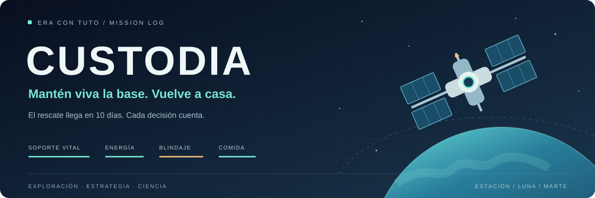

<div align="center">



**EL SOL NO NEGOCIA. LA BASE NO SE MANTIENE SOLA. VOS TENÉS DIEZ DÍAS.**

Supervivencia espacial, sigilo y mantenimiento bajo presión. Una IA que empieza a fallar, una tripulación que depende de vos y una nave de rescate que todavía está demasiado lejos.

```text
CUSTODIA OS // EXPEDIENTE DE MISIÓN
─────────────────────────────────────────
DESTINO       ESTACIÓN / LUNA / MARTE
RESCATE       DÍA 10
SISTEMAS      SOPORTE VITAL · ENERGÍA
              BLINDAJE · COMIDA
DIRECTIVA     MANTENER VIVA LA BASE
─────────────────────────────────────────
CONTROL: «¿ME RECIBÍS?»
```

[](https://custodia-six-phi.vercel.app/?cadete)
[](https://custodia-six-phi.vercel.app/?jurado)

**3 destinos** · **10 días hasta el rescate** · **4 sistemas conectados** · **1 base que depende de ti**

Sin cuenta ni instalación · funciona sin internet tras la primera visita · [Play in English](https://custodia-six-phi.vercel.app/?cadete&lang=en)

NASA Space Apps 2026 · desafío **Space Mission Design Game** · equipo **#EraConTuto** · Santa Cruz, Bolivia

[](https://github.com/invertilo/custodia)
[](#pruebas-y-simulaciones)


[Tu orden de misión](#tu-orden-de-misión) · [Cómo jugar](#cómo-jugar) · [Para aprender](#pensado-para-aprender) · [Idiomas](#idiomas-y-voces) · [La IA](#una-ia-que-aprende-tus-rutinas) · [Ciencia](#del-sol-real-a-tu-partida) · [Cooperativo](#dos-computadoras-una-tripulación) · [Desarrollo](#ejecutar-en-local) · [Equipo](#equipo) · [English](#english-summary)

</div>

---

## Tu orden de misión

La Tierra queda lejos. La IA de la base empieza a fallar. La nave **ESPERANZA** viene por ustedes, pero llega al **día diez**. Hasta entonces, el turno es tuyo.

Revisá los sistemas. Administrá lo que queda. Atendé emergencias. Cuando suene la alerta solar, decidí qué tarea dejás a medias para llegar al refugio. La vigilancia recuerda por dónde pasaste; entre una revisión y otra, podés encontrar notas, secretos y piezas para un regreso anticipado.

**Ganás manteniendo viva la base hasta el rescate.** Escapar antes es una ruta alternativa. Acá la épica también es acordarte del filtro de oxígeno.

> **Doctrina de vuelo:** la energía sostiene el soporte vital; el blindaje reduce la exposición; el mantenimiento consume tiempo. Hacete el toro con la lista de revisiones. El Sol va a hacer lo suyo.

## Elegí tu frente

| Destino | IA de la base | El reto |
| :--- | :--- | :--- |
| **Estación espacial** | CUSTODIA | Mantén una estación entre drones, fugas y emergencias orbitales. |
| **Luna · Shackleton** | SELENE | Cuida una base lunar entre polvo, radiación y peligros en la superficie. |
| **Marte · Jezero** | ARES | Administra una colonia con tormentas, robots averiados y recursos que se deterioran. |

Tres destinos, tres inteligencias a cargo: **CUSTODIA, SELENE y ARES**. Cada uno tiene su mapa, amenazas y refugio. Si vas a pisar la superficie, llevá traje. Las ganas no cuentan como blindaje.

En cada base hay **6 notas escondidas en los cajones**. Reunirlas todas, en una o varias partidas, desbloquea el **final verdadero** de ese destino.

## Cómo jugar

Abrí la [misión en modo Cadete](https://custodia-six-phi.vercel.app/?cadete), elegí un destino y pulsá **JUGAR**. Entrás desde el navegador, sin cuenta ni instalación obligatoria; en teléfono y tablet tenés controles táctiles.

**¿Viniste a ver de qué está hecho?** La [demo de tormenta solar](https://custodia-six-phi.vercel.app/?jurado) te deja en el día 2, a minutos del evento. Alarma, refugio y decisiones: directo al asunto.

1. **Cumplí la rutina.** La base tiene horarios de comida, trabajo, ejercicio y descanso.
2. **Ganate el rescate.** De 08:00 a 12:00, revisá los cuatro sistemas en sus paneles. Ese es tu turno de mantenimiento.
3. **Respondé a las emergencias.** Buscá la herramienta necesaria y resolvé el protocolo del peligro.
4. **Respetá la alerta solar.** Refugiarte corta tu tarea; seguir afuera aumenta tu exposición. Elegí con esa cuenta clara.
5. **Llegá al día 10.** El rescate valora cómo cuidaste los sistemas, la base y tu exposición a radiación. Volver con todos es la misión.

### Enlaces directos

| Dirección | Qué hace |
| :--- | :--- |
| [`?cadete`](https://custodia-six-phi.vercel.app/?cadete) | Empieza en el nivel Cadete, para 7–12 años. |
| [`?jurado`](https://custodia-six-phi.vercel.app/?jurado) | Demo: entra en el día 2, poco antes de la tormenta solar. |
| `?lang=en` · `?lang=he` | Cambia el idioma a inglés o hebreo. |
| `?sala=CÓDIGO` | Entra como Tripulante en una sala cooperativa; agregá `&rol=mcc` para Control de Misión. |
| `?boot` · `?noboot` | Fuerza o quita el arranque animado «CUSTODIA OS». |

Se pueden combinar: `?cadete&lang=en`.

### Cuatro sistemas, una sola misión

| Sistema | Qué debes cuidar |
| :--- | :--- |
| **Soporte vital** | Mantener las condiciones que permiten vivir en la base. |
| **Energía** | Sostener los demás sistemas; con poca energía, su deterioro se acelera. |
| **Blindaje contra radiación** | Reducir la dosis que acumulas durante la misión. |
| **Comida** | Conservar el abastecimiento para resistir hasta el rescate. |

Entre turnos podés explorar, ayudar a tus compañeros, fabricar herramientas, usar conductos y reunir las piezas de un regreso anticipado. La base sigue necesitando mantenimiento mientras armás tu plan.

### Elegí cuánto aprieta la misión

| Nivel | Experiencia |
| :--- | :--- |
| **Cadete · predeterminado** | Pensado para 7–12 años: menos daño, herramientas de emergencia y compañeros que ayudan con peligros sin resolver. |
| **Fácil** | Más margen para aprender las rutinas y explorar. |
| **Normal** | Gestión y sigilo con una vigilancia que se vuelve más exigente. |
| **Terror** | Una escalada de vigilancia más intensa y menos margen de error. |

Hay campaña, modo **UNA NOCHE**, reto diario y emergencias de **REFLEJOS** opcionales. Podés ajustar música, sonidos y efectos visuales suaves; también se respeta la preferencia del sistema de reducir movimiento.

**Primer vuelo: Cadete.** Para subir la tensión tenés Normal y Terror. El nivel cambia el margen de error; la orden sigue siendo volver a casa.

### Controles

| Acción | Tecla |
| :--- | :--- |
| Moverse | `WASD` o flechas |
| Usar, hablar o interactuar | `E` |
| Fabricar / abrir mochila | `C` / `I` |
| Esconderse / lanzar una pieza / soltar un objeto | `F` / `T` / `G` |
| Usar inhibidor | `Q` |
| Mantenimiento, plan, amenazas y registro | `1` · `2` · `3` · `4` |
| Pausa / menú | `P` / `Esc` |
| Música / nombres del mapa / pantalla completa | `M` / `N` / `V` |

## Pensado para aprender

Aprendés tomando decisiones y viendo sus consecuencias. ¿Seguiste trabajando durante la tormenta? La dosis queda en la cuenta. ¿Dejaste caer la energía? Los otros sistemas lo sienten. La bitácora de la misión conecta lo que hiciste con lo que pasó.

El modo **Cadete** está pensado para **7–12 años**: entrenamiento guiado, ayuda de la tripulación y herramientas para aprender sin perderse en la primera alarma.

| Ayuda | Para qué sirve |
| :--- | :--- |
| **Entrenamiento guiado** | Tutorial de 7 pasos con una flecha que señala cada panel; se puede saltar y repetir desde el inicio. |
| **Leer en voz alta** | Lee las ventanas y los avisos importantes para quien todavía lee poco. |
| **Pregunta de cierre** | Una pregunta al terminar la misión, para comprobar qué idea quedó. |
| **Certificado de Cadete** | Al ganar, un certificado con el nombre del jugador para descargar o compartir. |
| **Modo clase y panel docente** | Cada alumno copia su resultado; el docente pega las líneas y obtiene un resumen por clase, con exportación a CSV. |
| **Sin internet** | Después de la primera visita el juego funciona sin conexión y se puede instalar en compu, tablet o celular. |

## Idiomas y voces

| Idioma | Texto | Voces |
| :--- | :---: | :---: |
| **Español** | Completo | Voz de la IA en el arranque y lectura en voz alta |
| **English** | Completo | AI voice on the boot screen and read-aloud |
| **עברית (hebreo)** | Pantallas principales; el resto sale en inglés | Sin voces, solo texto |

El idioma se elige con los botones **ES · EN · עב** del inicio o con `?lang=en` / `?lang=he` en la dirección. Las voces grabadas de la IA están en [`audio/voz/`](audio/voz/) y las traducciones al hebreo en [`src/he.js`](src/he.js).

## Una IA que aprende tus rutinas

**Tu escondite favorito puede dejar de serlo.** Al principio tenés más margen para conocer la base. Conforme avanzan los días, los drones **se mueven más rápido, ven más lejos y mantienen la búsqueda durante más tiempo**. Las cámaras y los guardias también confirman antes sus sospechas.

La IA recuerda lugares por los que te vio pasar y escondites donde vio tu entrada. Si repetís un recorrido, puede enviar patrullas a investigarlo. Cambiar de hábitos ayuda: los recuerdos antiguos pierden peso con el tiempo. El pasillo de siempre empieza a costar más.

- **Observación:** respeta paredes, conos de visión, oscuridad, escondites y conductos.
- **Progresión:** la intensidad depende del nivel; en Cadete es suave y solo aprende recorridos si hay conducta sospechosa.
- **Persistencia:** la memoria se conserva al guardar y empieza de cero en una misión nueva.
- **Decisiones locales:** funciona con reglas y memoria del juego, sin modelos externos ni servicios de IA.

En **Normal, al día 10**, los drones tienen un **27 % más de velocidad**, **22 % más de alcance visual** y mantienen el rastro hasta **7 segundos**, frente a los 3 iniciales.

→ [Reglas de la IA, análisis técnico y límites de las pruebas](docs/analisis/ia-progresiva.md)

## Del Sol real a tu partida

**El Sol pone los datos. Vos tomás la decisión.** El juego consulta llamaradas solares de los últimos 30 días en **NASA DONKI** y las utiliza para seleccionar tres tormentas durante la misión. Si la consulta falla, utiliza eventos reales archivados e indica que los datos no son en vivo.

La decisión es jugable: **refugiarte reduce la dosis de la tormenta, pero interrumpe tu tarea y consume energía; continuar permite seguir trabajando, con mayor exposición**.

| Fuente | Su papel en CUSTODIA |
| :--- | :--- |
| [NASA DONKI · CCMC](https://ccmc.gsfc.nasa.gov/tools/DONKI/) | Eventos de clima espacial utilizados para las tormentas. |
| [NASA Open APIs](https://api.nasa.gov/) | Acceso a datos y solicitud de una llave propia. |
| [NASA Open Science Data Repository](https://science.nasa.gov/biological-physical/data/) | Estudios citados en DATOS NASA sobre salud y vida en el espacio. |
| Procedimientos de la ISS y mediciones de misiones espaciales | Referencias educativas de protocolos y diferencias entre destinos, consultables dentro del juego. |

> **Datos, simplificación y ficción:** los eventos solares pueden ser reales; las dosis de cada tormenta, los tiempos, el límite de misión y el balance son escalas del juego. Los protocolos distinguen procedimientos simplificados, riesgos reales y ficción. CUSTODIA es una experiencia educativa, no una simulación operativa ni un producto oficial de NASA.

<details>
<summary><strong>Configurar una llave de NASA — opcional</strong></summary>

1. Solicitá una llave en [api.nasa.gov](https://api.nasa.gov/).
2. En el inicio del juego, abrí **DATOS NASA**.
3. Pegá la llave en **Llave de api.nasa.gov** y pulsá **USAR LLAVE**.

La llave se guarda en ese navegador. No debés subirla al repositorio. Sin una llave propia se intenta consultar con `DEMO_KEY`; si el servicio no responde, la misión sigue con llamaradas archivadas.

</details>

## Dos computadoras, una tripulación

**«Control, acá la base. Nos vendría bien una mano.»**

Una persona lleva al **Astronauta**. La segunda entra desde **SEGUNDO JUGADOR** y elige su puesto:

| Puesto | Qué hacés |
| :--- | :--- |
| **Tripulante** | Manejás a un compañero en el mismo mapa: revisás sistemas, atendés emergencias de reflejos, distraés vigilancia, buscás suministros y se los pasás al astronauta. |
| **Control de Misión** | Ves el mapa, los sistemas y el clima espacial. Podés reasignar recursos, abrir escotillas sin candado, marcar un punto y enviar avisos prefabricados. |

Las órdenes de Control tienen retraso según el destino: inmediato en la Estación y retrasado en Luna y Marte, a escala de juego. Avisá con tiempo: la radio también juega.

<details>
<summary><strong>Conectarse en la misma red</strong></summary>

Desde la carpeta del proyecto:

```bash
npm run coop
```

El servidor muestra las direcciones de red. Abrí el juego, entrá en **COOPERATIVO**, creá una sala como Astronauta y compartí el enlace que aparece. La otra persona puede entrar como Tripulante o elegir Control de Misión desde **SEGUNDO JUGADOR**. Ambas computadoras deben poder comunicarse por esa red.

Si no conecta, comprobá que estén en la misma WiFi y que el firewall permita el servidor en redes privadas. Algunas redes escolares aíslan los dispositivos; probá con otra red o un hotspot. El enlace local intenta reconectarse si se corta.

</details>

<details>
<summary><strong>Conectarse mediante códigos manuales</strong></summary>

Funciona desde un sitio estático como GitHub Pages: el Astronauta genera una invitación, Control genera una respuesta y se la devuelve. La conectividad depende de que las redes permitan la conexión WebRTC entre ambos navegadores.

</details>

## Ejecutar en local

**Abrí tu propia base.** Necesitás Git y una versión moderna de Node.js. El juego y el servidor local arrancan sin instalar dependencias ni compilar.

```bash
git clone https://github.com/invertilo/custodia.git
cd custodia
node tools/serve.mjs 8000
```

Abrí [localhost:8000](http://localhost:8000/). Usá [modo Cadete](http://localhost:8000/?cadete) para empezar o la [demo de tormenta](http://localhost:8000/?jurado) para entrar en el día 2, poco antes del evento solar.

Los módulos de JavaScript requieren un servidor: abrir `index.html` directamente con `file://` no basta. Si tenés Python, también podés usar `python -m http.server 8000` para jugar en solitario.

### Pruebas y simulaciones

```bash
npm test                                  # Pruebas de lógica y servidor
node tools/sim.mjs estacion 4 cadete 11     # Destino, partidas, nivel y días
node tools/sim.mjs luna 4 cadete 11
node tools/sim.mjs marte 4 cadete 11
```

`npm test` ejecuta las pruebas de lógica y servidor con el runner de Node.js. Las simulaciones ayudan a detectar problemas de equilibrio; sus bots no sustituyen pruebas con jugadores. Los resultados y limitaciones están en el [análisis técnico](docs/analisis/ia-progresiva.md).

<details>
<summary><strong>Pruebas en navegador con Playwright</strong></summary>

Playwright es una herramienta de desarrollo opcional; no es una dependencia del juego.

```bash
npm install --no-save --package-lock=false playwright
npx playwright install chromium
npm run e2e
npm run e2e:coop
```

Las capturas se guardan en `e2e-out/`. Podés indicar un navegador instalado mediante `CHROME_PATH`. La instalación de Chromium descarga el navegador de prueba.

</details>

### Mapa del código

| Archivo | Responsabilidad |
| :--- | :--- |
| [`src/core.js`](src/core.js) | Simulación, acciones, inventario, guardado y finales. |
| [`src/locs.js`](src/locs.js) · [`src/common.js`](src/common.js) | Los tres destinos (mapas, IA, tripulación, finales) y datos compartidos: piezas, recetas y protocolos. |
| [`src/variedad.js`](src/variedad.js) · [`src/story.js`](src/story.js) · [`src/meta.js`](src/meta.js) | Variedad entre partidas, notas del final verdadero y progreso guardado (medallas, racha, reto diario). |
| [`src/ia.js`](src/ia.js) · [`src/villains.js`](src/villains.js) | Progresión, memoria, sospecha y amenazas. |
| [`src/sistemas.js`](src/sistemas.js) | Sistemas de la base, mantenimiento y tormentas. |
| [`src/clima.js`](src/clima.js) · [`src/datos.js`](src/datos.js) | Clima espacial, datos y referencias. |
| [`src/main.js`](src/main.js) · [`src/arte.js`](src/arte.js) | Interfaz, controles y dibujo en Canvas. |
| [`src/ui.js`](src/ui.js) · [`src/avisos.js`](src/avisos.js) · [`src/fx.js`](src/fx.js) · [`src/cuerpos.js`](src/cuerpos.js) | Decisiones de interfaz, avisos en pantalla, efectos y dibujo de los astronautas. |
| [`src/personajes.js`](src/personajes.js) · [`src/informe.js`](src/informe.js) | Personalidad de la tripulación y bitácora final («qué pasó cada día y por qué»). |
| [`src/music.js`](src/music.js) · [`src/sonido.js`](src/sonido.js) | Música generativa y efectos con WebAudio, sin archivos de audio. |
| [`src/coop.js`](src/coop.js) · [`src/link.js`](src/link.js) · [`src/coopui.js`](src/coopui.js) | Reglas cooperativas, comunicación y pantallas de Control de Misión. |
| [`src/tutorial.js`](src/tutorial.js) · [`src/quiz.js`](src/quiz.js) · [`src/certificado.js`](src/certificado.js) · [`src/docente.js`](src/docente.js) | Entrenamiento guiado, pregunta de cierre, certificado y panel docente. |
| [`src/i18n.js`](src/i18n.js) · [`src/he.js`](src/he.js) · [`src/voz.js`](src/voz.js) · [`src/inicio.js`](src/inicio.js) | Idiomas, lectura en voz alta y pantalla de arranque. |
| [`sw.js`](sw.js) · [`manifest.webmanifest`](manifest.webmanifest) | Modo sin internet e instalación. |
| [`tests/`](tests/) · [`tools/`](tools/) | Pruebas, servidor y simuladores. |

La lógica funciona sin pantalla, usa azar con semilla y puede serializarse. El juego está hecho con **HTML, CSS y JavaScript**, sin un motor externo. Antes de contribuir, consultá [`CONTEXTO.md`](CONTEXTO.md) y las [reglas del proyecto](CLAUDE.md); `referencias/` contiene copias de consulta.

## English summary

**CUSTODIA** is a browser game about keeping a space base alive until rescue arrives in ten days. Players maintain life support, power, radiation shielding and food while responding to emergencies on a Space Station, the Moon or Mars.

Solar events from NASA DONKI inspire the mission's storms. Players choose between sheltering and continuing their tasks, balancing exposure, time and energy. Cadet mode supports younger players; higher difficulties introduce stronger surveillance and an AI that remembers observed routes. A second player can control a crewmate on the same map or join as Mission Control; Mission Control commands use simulated communication delays.

The project addresses **Space Mission Design Game**. Scientific sources, simplified mechanics and fictional elements are identified separately. [Play in Cadet mode](https://custodia-six-phi.vercel.app/?cadete) · [Try the solar storm demo](https://custodia-six-phi.vercel.app/?jurado).

## Equipo

**#EraConTuto · Santa Cruz, Bolivia.**

Desde Santa Cruz hasta Jezero, con escala en un panel de mantenimiento. Hicimos CUSTODIA para aprender ciencia espacial tomando decisiones, cuidar a la tripulación y tener una buena historia que contar al volver.

<table>
<tr>
<td align="center"><a href="https://github.com/invertilo"><br><b>Vinicius Salazar</b><br><sub>@invertilo</sub></a></td>
<td align="center"><a href="https://github.com/alejondr3"><br><b>Alejandro Mendoza</b><br><sub>@alejondr3</sub></a></td>
<td align="center"><a href="https://github.com/leoaguilerasc-design"><br><b>Leonardo Aguilera</b><br><sub>@leoaguilerasc-design</sub></a></td>
<td align="center"><a href="https://github.com/NeckHurtttt"><br><b>Sergio Santiago Rioja Coca</b><br><sub>@NeckHurtttt</sub></a></td>
</tr>
<tr>
<td align="center" colspan="2"><a href="https://github.com/rodrigocam"><b>Rodrigo Reynaldo Camacho Marangani</b><br><sub>@rodrigocam</sub></a></td>
<td align="center" colspan="2"><a href="https://github.com/luxero123x"><b>Joshua Villagomez</b><br><sub>@luxero123x</sub></a></td>
</tr>
</table>

## Créditos

- **Jugar:** [custodia-six-phi.vercel.app](https://custodia-six-phi.vercel.app/).
- **Repositorio:** [github.com/invertilo/custodia](https://github.com/invertilo/custodia). Une el trabajo de `NeckHurtttt/proyecto-Hackaton-2.0` y de `leoaguilerasc-design/Hackaton-2.0-en-compu-de-Leo`, con el historial de ambos.
- **CUSTODIA** nació con el nombre *LIFELINE: Rutina*; la versión de Leo se conserva en la etiqueta `base-leo`.
- Tipografía **VT323**, distribuida bajo [SIL Open Font License](fonts/OFL-VT323.txt).
- **Asistencia de IA:** Claude (Anthropic) y Codex (OpenAI) han apoyado tareas de programación, análisis y documentación. Las decisiones de diseño y la validación con jugadores corresponden al equipo; las fuentes científicas se citan por separado.

---

<div align="center">

**DIEZ DÍAS. CUATRO SISTEMAS. TODA TU TRIPULACIÓN.**

La nave viene. Que encuentre la base en pie.

**Hecho en Bolivia. Se juega con aguante. Se gana cuidando. 🐂**

[Empezar la misión →](https://custodia-six-phi.vercel.app/?cadete)

</div>
